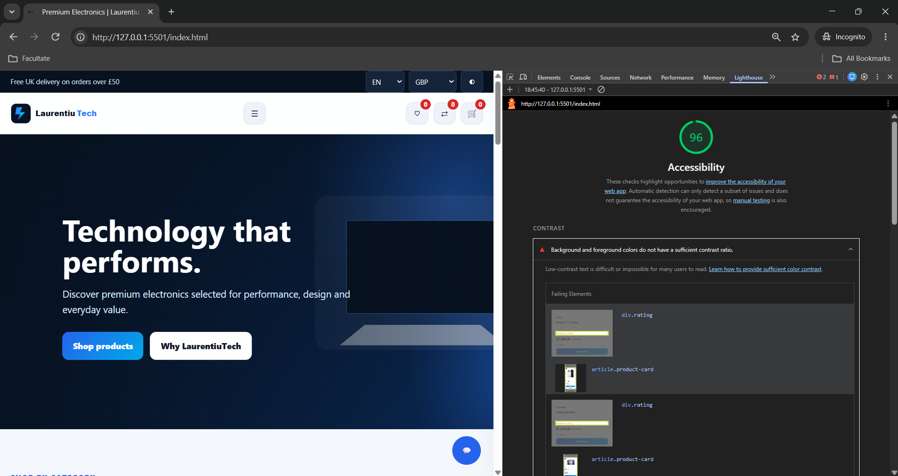
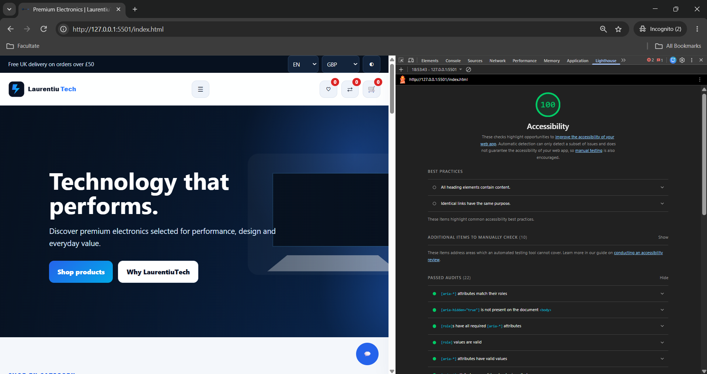
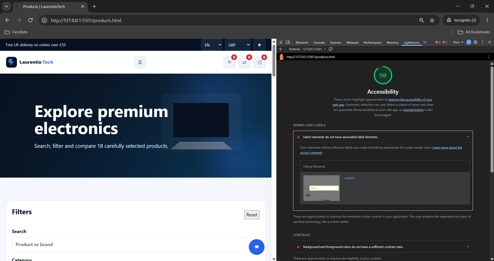
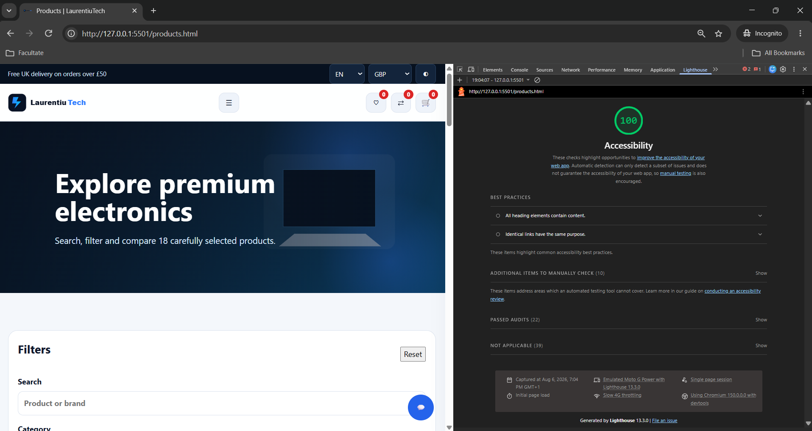

# LaurentiuTech

### Responsive E-Commerce Website | Front-End Development & User Experience

**Individual Software Development Project | 2026**

LaurentiuTech is a responsive, interactive e-commerce website developed using HTML5, CSS3 and vanilla JavaScript.

The project demonstrates practical front-end development through a multi-page electronics shopping experience, incorporating dynamic product data, interactive shopping features, multilingual support, currency selection, responsive design and accessibility improvements.

The application was designed and implemented as an individual academic project and is presented here as part of my professional technology portfolio.

---

## Project Overview

LaurentiuTech was developed to demonstrate the design and implementation of an interactive online shopping experience without relying on front-end frameworks.

The project brings together several important aspects of web development:

- Semantic HTML and structured page layouts.
- Responsive, mobile-first interface design.
- Dynamic content rendering with JavaScript.
- Client-side state management and browser storage.
- Interactive product selection and shopping workflows.
- Multilingual user interface functionality.
- Accessibility evaluation and improvements.
- Organised source code and reusable interface components.

The result is a functional front-end prototype that can be explored locally or deployed through a static website hosting service.

---

## Key Features

### 1. Interactive Product Catalogue

The website includes 18 technology products organised into multiple categories.

Key capabilities include:

- Dynamic product listings powered by JavaScript data.
- Product search and filtering.
- Product sorting.
- Dedicated product details pages.
- Multiple product images and gallery navigation.
- Product variants, including available colours and configurations.
- Price and image updates based on selected options.
- Related-product recommendations.
- Stock information and availability messaging.

Product information is managed within the front-end application rather than retrieved from a live commercial inventory system.

### 2. Shopping Cart

LaurentiuTech includes an interactive shopping cart with:

- Add-to-cart functionality.
- Quantity adjustments.
- Product removal.
- Price and order-total calculations.
- Browser-based cart persistence using LocalStorage.
- Stock-related quantity validation.
- Cart indicators within the navigation interface.

The cart demonstrates client-side state management and interaction between different parts of the application.

### 3. Wishlist and Product Comparison

Users can explore products using dedicated wishlist and comparison interfaces.

Features include:

- Adding and removing wishlist items.
- Selecting products for comparison.
- Viewing chosen products through interactive interface components.
- Navigation indicators showing selected item counts.

These features demonstrate dynamic interface updates and reusable JavaScript logic.

### 4. Checkout Experience

The website contains a structured checkout interface designed to simulate an online shopping workflow.

The checkout includes:

- Customer and delivery information fields.
- Order summary and pricing information.
- Conditional interface fields for card and PayPal payment options.
- Input validation and user feedback.

**Important:** Checkout is a demonstration feature. LaurentiuTech does not process real payments, connect to a payment provider or submit real customer orders to a production backend.

### 5. Multilingual User Interface

LaurentiuTech provides language selection for six languages:

- English
- Romanian
- Spanish
- Italian
- French
- German

The interface uses JavaScript-based translation resources to update supported text and labels according to the selected language.

### 6. Multiple Currency Options

The website supports displaying prices in different currencies:

- GBP — British Pound
- EUR — Euro
- USD — US Dollar
- RON — Romanian Leu

Currency switching demonstrates dynamic price presentation within the front-end application.

Displayed conversions are for demonstration purposes and should not be treated as live foreign-exchange quotations.

### 7. Theme and User Interface Customisation

The website provides:

- Light and dark appearance options.
- Responsive navigation.
- Interactive product cards.
- Search and filtering controls.
- Dynamic cart, wishlist and comparison indicators.
- Visual feedback for user interactions.

### 8. Contact and Customer Support Interfaces

Additional front-end features include:

- Contact form.
- Newsletter interface.
- Interactive support chatbot.
- User-facing validation and feedback.

These are demonstration interfaces rather than connections to a production customer-support or email-processing system.

---

## Technology Stack

| Area | Technologies |
|---|---|
| Page Structure | HTML5 |
| Styling | CSS3 |
| Application Logic | Vanilla JavaScript |
| Product Data | JavaScript data structures |
| Client-Side Persistence | LocalStorage |
| Responsive Design | CSS media queries |
| Accessibility Testing | Google Chrome Lighthouse |
| Development Tools | Visual Studio Code, Chrome DevTools |
| Version Control | Git and GitHub |
| Hosting | Static website hosting / GitHub Pages |

**No React, Angular, Vue or Bootstrap frameworks are required.**

The project focuses on understanding and implementing core web technologies directly.

---

## Application Structure

```text
LaurentiuTech/
|
|-- index.html
|-- products.html
|-- product-details.html
|-- about.html
|-- contact.html
|-- cart.html
|-- checkout.html
|
|-- css/
|   |-- style.css
|   |-- responsive.css
|
|-- js/
|   |-- script.js
|   |-- products.js
|   |-- translations.js
|
|-- images/
|   |-- Product images and interface assets
|
|-- evidence/
|   |-- problem1.png
|   |-- fix1.png
|   |-- problem2.png
|   |-- fix2.png
|
|-- README.MD
```

The source code is organised into separate files for page structure, responsive styling, application behaviour, product information and interface translations.

---

## User Experience and Responsive Design

LaurentiuTech was developed with attention to interface consistency and usability across different screen sizes.

The website includes:

- Responsive page layouts.
- Mobile-friendly navigation and interface elements.
- Consistent visual hierarchy.
- Clear product information and action buttons.
- Interactive feedback for shopping operations.
- Accessible labels and descriptive interface elements.

The project demonstrates the importance of combining technical functionality with a usable and understandable interface.

---

## Accessibility Testing and Improvements

Accessibility was evaluated using Google Chrome Lighthouse as part of the development and assessment process.

The evaluation identified areas requiring improvement, which were addressed and documented through before-and-after screenshots.

The work included accessibility-related refinements such as:

- Improved text and interface contrast.
- More descriptive image alternatives.
- Accessible names and labels for interactive controls.
- Clearer semantic structure.
- Keyboard-navigation and focus considerations.

### Accessibility Evidence — Example 1

**Before:**



**After:**



*Figure 1. Lighthouse accessibility evaluation — first documented problem and subsequent improvement.*

### Accessibility Evidence — Example 2

**Before:**



**After:**



*Figure 2. Lighthouse accessibility evaluation — second documented problem and subsequent improvement.*

These screenshots provide evidence of the accessibility review and the changes made during development.

Lighthouse results reflect the assessed pages and testing conditions; they do not replace comprehensive accessibility testing with assistive technologies and real users.

---

## Development and Testing

The website was developed and evaluated through an iterative process.

### Development Activities

1. Planning the website structure and user experience.
2. Creating semantic HTML pages.
3. Implementing responsive CSS layouts.
4. Developing JavaScript-based product data and functionality.
5. Integrating cart, wishlist and comparison features.
6. Implementing interface translations and currency selection.
7. Building the simulated checkout and support features.
8. Testing browser behaviour and responsive layouts.
9. Conducting Lighthouse accessibility audits.
10. Applying and documenting accessibility improvements.

### Functional Testing

The project was reviewed through practical browser-based interaction and interface testing, including:

- Navigation between website pages.
- Product catalogue display.
- Search and filtering behaviour.
- Product variant selection.
- Cart quantity and total calculations.
- Wishlist and comparison interactions.
- Checkout field behaviour.
- Language and currency switching.
- Responsive interface presentation.

This repository does not claim an automated production test suite or real payment integration.

---

## My Role and Contributions

**Laurentiu-Marius Carlan**

**Individual Project Developer | Front-End Development | UI/UX Implementation | Accessibility Evaluation**

As the individual developer, I was responsible for the design, implementation and evaluation of the LaurentiuTech website.

My work included:

- Planning and structuring the multi-page website.
- Developing responsive layouts using HTML and CSS.
- Implementing dynamic JavaScript functionality.
- Managing product information and product variants.
- Building interactive cart, wishlist and comparison experiences.
- Developing client-side checkout interactions.
- Implementing multilingual and currency-selection features.
- Improving usability and visual consistency.
- Performing Lighthouse accessibility assessments.
- Documenting identified problems and implemented improvements.
- Organising the project files and preparing the final academic submission.

This project strengthened my practical understanding of front-end development, client-side application logic, debugging, usability and software documentation.

---

## Running the Project Locally

LaurentiuTech is a front-end application and does not require a database or backend installation.

### Requirements

- A modern web browser.
- Visual Studio Code or another suitable code editor.
- A local development server, recommended for consistent browser behaviour.

### Instructions

1. Download or clone the repository.
2. Open the project folder in Visual Studio Code.
3. Start a local development server, such as the Live Server extension.
4. Open `index.html` through the local server.
5. Explore the product catalogue, interactive features and checkout demonstration.

Some browser features may behave differently when the website is opened directly through a `file://` address.

---

## Project Limitations

LaurentiuTech was developed as an educational front-end prototype rather than a production e-commerce service.

The current implementation does not include:

- A production backend or relational database.
- Real payment processing.
- Live inventory synchronisation.
- Real customer-account management.
- Commercial order fulfilment.
- Production email or customer-support integrations.

The project focuses on demonstrating front-end engineering, interactive application behaviour and accessible interface development.

---

## Future Development

Potential improvements include:

- Introducing a secure backend and database.
- Developing user registration and authentication.
- Implementing server-side inventory management.
- Integrating a payment provider in a suitable test environment.
- Adding automated unit and end-to-end tests.
- Extending accessibility evaluation.
- Improving performance and image optimisation.
- Developing a complete order-management workflow.

These enhancements could extend LaurentiuTech from a front-end prototype into a more comprehensive full-stack application.

---

## Project Background

LaurentiuTech was developed as an individual academic project and is presented in this repository as part of my personal technology portfolio.

The project demonstrates practical application of web development principles, JavaScript programming, responsive design, user interaction and accessibility evaluation.

**Repository:**  
https://github.com/CLM1398/LaurentiuTech

---

## Developer

**Laurentiu-Marius Carlan**

Computing Undergraduate | Technology & Digital Innovation

**GitHub:** https://github.com/CLM1398

**LinkedIn:**  
https://www.linkedin.com/in/laurentiu-marius-carlan-79081a333/

---

*LaurentiuTech — an individual front-end development project demonstrating interactive web applications, accessible design and practical software engineering skills.*
